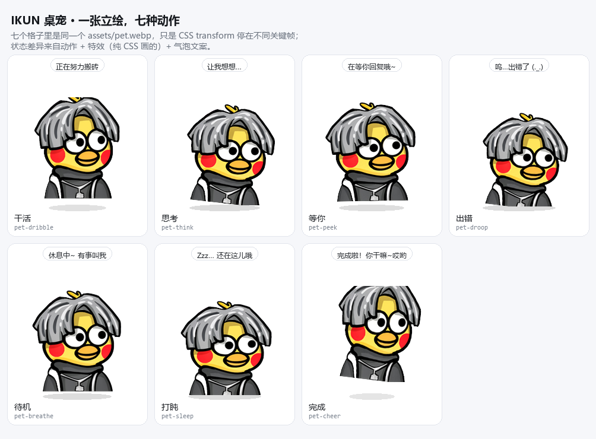

# 🐤 IKUN 桌宠 · dsh-ikun-pet

> 一只灰发、背带裤的小鸡住在 DSH Web 界面右下角。它**只有一张立绘**——
> 所有状态差异都来自**动作、特效和聊天气泡**。
> 干活时它像在运球一样弹跳，思考时歪着头，等你回复时凑过来问，
> 任务完成时蓄力跳起来并喊出 **「你干嘛~」** 🏀

这是一个**宿主组合级插件包**（host-composition bundle），不是会话级动态插件：
装上以后每个窗口、每个会话都能看到它。

先看效果：用浏览器打开 [`preview/index.html`](preview/index.html)，七个格子里的 `` 是同一个文件，
动作会同时跑起来。



---

## 🎬 一张立绘，七种动作

角色始终是同一个人，不会因为换图而「变脸」，也不会闪。状态差异来自三样东西：

| 通道 | 做什么 | 为什么 |
|---|---|---|
| **动作** | 每个状态一套 CSS `@keyframes`，只动 `transform` | 支点在**身体底部**（`transform-origin: 50% 94%`），所以起跳、歪头、被拖走都像「站在地上」，而不是一张贴纸在飘 |
| **特效** | 汗滴 / Z / 彩纸 / 思考点，纯 CSS 画的小元素 | 不增加任何素材，就能把「忙」「困」「开心」读出来 |
| **气泡** | 一句中文 | 唯一能说清「它在等什么」的通道 |

| Host 端 `mode` | 触发条件 | 动作 | 特效 | 滤镜 | 气泡 |
|---|---|---|---|---|---|
| `working` | 有工具在执行，或刚跑完 2.5s 内 | 快速弹跳、挤压拉伸 | 两颗汗滴飞出 | 提饱和 | 正在努力搬砖 🏀 |
| `review` | Agent `running` 但没有工具活动 | 缓缓左右歪头 | 三个思考点 | — | 让我想想… |
| `waiting` | 审批请求 / `ask_user_question` 挂起 | 前倾探头、小幅张望 | 一个跳动的 `?` | — | 在等你回复哦~ |
| `failed` | `agent/error` / `agent/request-error` | 抖两下，然后垂头沉下去 | 两颗大汗滴 | 去饱和压暗 | 呜…出错了 (._.) |
| `idle` | 没有任何 Agent 在跑 | 缓慢呼吸起伏 | — | — | 休息中~ 有事叫我 |
| `sleeping` | 空闲超过 75 秒 | 更慢更沉的呼吸 | 三个 `Z` 往上飘 | 微压暗 | Zzz… 还在这儿哦 |
| `celebrating` | **所有 Agent 从「有人在跑」回到 0** | 蓄力下压 → 腾空 42px → 旋转落地 | 六片彩纸炸开 | 提亮提饱和 | 完成啦！你干嘛~哎哟 |
| — | 拖动 | 被拎着晃 | — | — | 呜哇~ 别拽我！ |
| — | 单击 | 跳一下（2.4s，复用庆祝动作） | — | — | 诶嘿~ 你干嘛~ |

地面阴影跟着离地高度缩放，这是让「跳起来」有重量的关键。

## 🚀 安装

```sh
dsh plugin --profile desktop add /绝对路径/dsh-ikun-pet
```

也可以直接从 GitHub 装（仓库里已提交构建产物，装的时候不需要构建）：

```sh
dsh plugin --profile desktop add github:sdxJulLeo/dsh-ikun-pet
```

> ⚠️ **装完必须重启一次 DSH。** 这不是本插件的特殊要求，而是 DSH 对 profile
> 包变更的既定行为：新连接的包要走新的 runtime resolution，改动的模块要重新
> import。插件管理器会报告 `applied`（Loader 条目确实已激活），但运行中的进程
> 仍然持有旧的模块缓存与旧的包映射。重启后刷新页面即可看到桌宠。

### 验证是否生效

```sh
curl http://127.0.0.1:19387/ikun-pet/state
# {"mode":"idle","seq":0,"celebrateSeq":0,"ready":true,"missing":[],
#  "pet":"/ikun-pet/pet.webp","voice":"/ikun-pet/voice.mp3",...}
```

`mode` 会实时反映 Agent 在干什么。排错看这几个字段：

| 现象 | 含义 | 处理 |
|---|---|---|
| `ready: false`、`pet: null` | 立绘没读出来 | 看 `missing` 列了什么，检查 `assets/` 是否完整 |
| `ready: false` 但文件都在 | 旧版本的已知自锁 | 见下 |

> **已知自锁（v2.0.0 已修）**：早期版本把 `ready` 写成「缓存里是否已有全部素材」，
> 而缓存只在**有人请求素材时**才填充，客户端又要等 `ready === true` 才去请求图片。
> 两边互等，桌宠就永远停在 🐤 兜底状态。
> 现在改成插件启动时主动把素材读进内存，`ready` 反映的是「文件到底读不读得出来」。
> `test/selftest.mjs` 里有一条「冷启动即为 ready」的断言专门钉住它。

## ⚙️ 配置

Host 半的所有可调项集中在 `lib/index.js` 顶部的 `DEFAULTS`：

| 键 | 默认 | 说明 |
|---|---|---|
| `pollMs` | `500` | 轮询 `agents` 服务的间隔，也是桌宠感知延迟的上限 |
| `celebrateMs` | `5200` | 庆祝动作持续时长 |
| `failedMs` | `2800` | 出错动作持续时长 |
| `recentToolMs` | `2500` | 最后一次工具活动后仍算「干活中」的时长 |
| `sleepAfterMs` | `75000` | 彻底没事干多久之后开始打盹 |
| `sweepMs` | `400` | 过期清扫间隔（防止漏事件后卡住） |

覆盖方式是在 `cordis.patch.yml` 的 insert 行里加 `config:`：

```yaml
- insert:
    - id: ikun-pet
      name: dsh-ikun-pet
      config:
        celebrateMs: 8000
        sleepAfterMs: 30000
```

浏览器侧的偏好（大小 / 静音 / 气泡 / 特效开关 / 位置）在桌宠上**右键**即可调整。
完成音需要页面先有一次用户交互才播得出来（浏览器自动播放策略），
点一下页面任意处就解锁了。

## 🧩 实现结构

```
dsh-ikun-pet/
├── package.json          # dsh.bundle.patch + dsh.client(platform: web) 声明
├── cordis.patch.yml      # 把自己插进 profile 插件树的那一行
├── lib/
│   ├── index.js          # Host 半：素材路由 + Agent 活动状态机
│   └── client.js         # Client 半：手写 __ModuleLoader__ bundle，动作 + 特效 + 气泡
├── assets/
│   ├── pet.webp          # 唯一一张立绘：512×512 透明无损 WebP，底部对齐
│   └── voice.mp3         # 「你干嘛~」完成音
├── preview/
│   ├── index.html        # 七种动作实时预览（不需要装 DSH）
│   └── motions.png       # 静态分镜：同一素材停在各自的关键帧峰值
└── test/
    ├── selftest.mjs           # 29 项：包契约 + 状态机 + 路由 + 素材降级
    └── client-render.test.mjs # 20 项：最小 React 运行时真跑一遍 Client 半
```

### 数据流

```
浏览器                                  宿主进程
  │
  │  GET /ikun-pet/state  (每 500ms)      ┌──────────────────────────────┐
  ├──────────────────────────────────────►│ agent/status      ─┐        │
  │  { mode, seq, celebrateSeq, ready,    │ tools/execute      ─┤→ 状态机 │
  │    pet, voice, missing }              │ approval/request   ─┤  → mode │
  │                                       │ user-questions/... ─┤        │
  │  GET /ikun-pet/pet.webp   ×1          │ agent/error        ─┘        │
  │  GET /ikun-pet/voice.mp3              │ agents.list()   (轮询兜底)   │
  │                                       └──────────────────────────────┘
  │  POST /ikun-pet/claim { seq }
  └──────────────────────────────────────► 只有第一个认领的页面拿到 play:true
```

`celebrateSeq` 是**单调递增**的完成计数器：只有它变化才代表「刚完成一次」，
所以刷新页面、重启宿主都不会误响，重复轮询也不会重播。

### 路由为什么是四条 exact 而不是一条 prefix

`dsh-host-webserver` 的匹配实现是：

```js
if (pathname !== prefix && !pathname.startsWith(`${prefix}/`)) continue;
```

也就是说前缀**不能带尾斜杠**——注册 `'/ikun-pet/'` 时，`/ikun-pet/state` 需要命中
`'/ikun-pet//'`，永远匹配不上。本插件因此逐条注册 exact 路由，
`test/selftest.mjs` 里有一项按同一套语义复刻的回归断言钉住这个坑。

### 素材是怎么来的

立绘取自开源仓库 [`wzwtt/ikun`](https://github.com/wzwtt/ikun) 的 `head_portrait/40.png`
（1920×1916）——同一只小鸡里最正、最对称、分辨率最高的一张，适合被反复变换。
它原本是斜条纹背景，加工流程是：

1. 把角色的黑色描边当墙做泛洪填充，从**任意**背景里抠出角色（不依赖背景颜色）；
2. 形态学闭运算补上抗锯齿造成的细缝（否则浅色脸蛋会被整片吃掉），填内部孔洞；
3. 羽化 alpha 边缘、按内容裁切、缩到 512×512 并**底部对齐**——
   这样 CSS 的 `transform-origin` 正好落在身体底部。

### 为什么不用 `host.call`

`host.call` 是**动态插件**（`cordis_define` 装载的那种）才有的私有 RPC。
静态插件包没有这个通道，官方推荐的 Host↔Client 通道就是
「Host 注册自有 HTTP 路由 + Client `fetch`」——本插件走的就是这条。

## 🧪 自检

```sh
node test/selftest.mjs            # Host 半
node test/client-render.test.mjs  # Client 半
```

`selftest` 用手写的假 Cordis ctx 驱动 Host 半，覆盖包契约、bundle 封装边界、
状态机全部模式迁移、路由的真实匹配语义、素材字节与 Content-Type、同源校验、
完成音去重、打盹与唤醒，以及「冷启动即为 ready」和「立绘缺失时如实降级」两条降级路径。

`client-render` 用一套最小 React 运行时 + 假 DOM 真正执行 `lib/client.js`：
逐状态断言动作 keyframes、特效种类、情绪滤镜、地面阴影、气泡文案，并专门断言
**七个状态用的是同一张立绘**（`src` 集合大小为 1）——这条断言的意义是防止实现
悄悄退回「换图表示状态」。

## ⚠️ 素材版权

- `assets/voice.mp3`：网络公开的二创梗语音片段（含公众人物声音），版权归原作者所有，
  **仅供个人学习交流**，请勿商用。
- `assets/pet.webp`：粉丝二创形象，取自开源仓库
  [`wzwtt/ikun`](https://github.com/wzwtt/ikun)（表情包大全），经抠图与归一化处理。
- 若您是权利人且不希望相关内容被展示，请联系删除。

代码以 [MIT License](LICENSE) 授权；`assets/` 目录不适用 MIT，遵循上面的声明。
